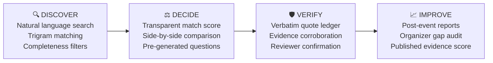

<div align="center">

# 🧭 BeforeYouGo
### *Know what an event promises before you go.*

**An event intelligence and accountability platform for college students and developers.**  
*Exposing missing details, quoting claims verbatim, and tracking promises with real evidence.*

[](https://python.org)
[](https://fastapi.tiangolo.com)
[](https://react.dev)
[](https://www.typescriptlang.org)
[-4169E1?style=for-the-badge&logo=postgresql&logoColor=white)](https://www.postgresql.org)
[](https://vitejs.dev)
[](https://docker.com)
[](#-testing--quality)

<p align="center">
  <a href="#-about-the-project">About</a> •
  <a href="#-the-4-step-event-loop">How It Works</a> •
  <a href="#-key-features">Features</a> •
  <a href="#%EF%B8%8F-tech-stack--architecture">Architecture</a> •
  <a href="#-quick-start">Quick Start</a> •
  <a href="#-testing--quality">Testing</a> •
  <a href="#-connected-sources">Sources</a>
</p>

---

</div>

## 💡 About the Project

College students, developers, and tech enthusiasts frequently invest significant time, money, and travel expenses into hackathons, conferences, and workshops—only to be met with misleading hype, unstated fees, missing schedules, or unfulfilled prize pools.

Most event directories function purely as bulletin boards or ticket distribution channels. They do not audit claims, nor do they highlight missing information.

**BeforeYouGo changes the paradigm:**
- 🚫 **"Not stated means unknown"**: If a listing doesn't explicitly state a fee, it is *not* assumed to be free. If accommodation is missing, it is flagged as *unknown*.
- 🔍 **Gaps Left Visible**: Information completeness is measured and surfaced prominently before you decide to register.
- 📜 **Verbatim Promises**: Claims regarding prizes, certificates, mentors, and perks are quoted word-for-word and tracked through an evidence ledger.
- 🛡️ **Accountability Loop**: Connects discovery to post-event verification, allowing students to report outcomes and organizers to close informational gaps.

---

## 🔄 The 4-Step Event Loop



1. **Discover** — Search events using conversational queries (e.g., *"free hackathon in Delhi with certificates"*). Filter by dates, budget, travel radius, and information completeness.
2. **Decide** — Review transparent fit scores based on your preferences. Compare up to 4 events side-by-side, inspect what is missing, and get generated questions to ask organizers.
3. **Verify** — Every promise (prizes, stipends, mentors, food) is preserved verbatim and tracked across states: `Advertised` ➔ `Corroborated` ➔ `Fulfilled`.
4. **Improve** — Attendees submit post-event outcome reports. Organizers run pre-publication audits and download structured verification reports to elevate credibility.

---

## ✨ Key Features

### 🔎 Intelligent Full-Text & Trigram Search
- Powered by PostgreSQL `pg_trgm` and full-text indexes for robust typo tolerance and natural query handling.
- Dynamic faceted filtering across dates, deadlines, registration fees, categories, and completeness thresholds.

### 🧪 Promise Analyzer & Hype Detector
- **Flyer & URL Ingestion**: Paste raw event text, submit a public URL (via an SSRF-safe fetcher), or upload PDF/image flyers (with Tesseract OCR extraction).
- **Verbatim Claim Extraction**: Identifies and categorizes claims into prizes, food, travel, accommodation, certificates, and mentorship.
- **Ambiguity Detection**: Highlights vague statements (*"exciting prizes"*, *"industry leaders"*, *"top perks"*) and flags missing critical variables.
- **Defensive Engineering**: Features built-in prompt injection defense to discard adversarial instructions embedded in flyers. Deterministic rule-based fallback guarantees reliability without an active LLM API key.

### 📊 Transparent Evidence Ledger & Provenance
- Clear provenance categorization for all data points:
  - 🏢 `Organizer-Provided`
  - 🌐 `Public Source`
  - 🎓 `Participant Report`
  - 🛡️ `Independently Reviewed`
- Evidence status indicates proof strength, never mere opinions or uncorroborated organizer claims.

### ⚖️ Multi-Event Comparison Matrix
- Compare up to 4 events side-by-side across dates, fees, travel estimates, verified promises, and information completeness.
- Highlights trade-offs instantly to help students make informed weekend travel decisions.

### 🛠️ Organizer Audit Hub
- Self-service pre-publication audit to identify gaps that typically trigger student inquiries.
- Ability to upload corroborating evidence (e.g., mentor confirmations, venue bookings) to raise promise verification status before the event starts.

---

## 🏗️ Tech Stack & Architecture

### Backend
- **Framework**: [FastAPI](https://fastapi.tiangolo.com) (Python 3.12)
- **Database & ORM**: PostgreSQL 16 with `pg_trgm` extension, [SQLAlchemy 2.0](https://www.sqlalchemy.org), [Alembic](https://alembic.sqlalchemy.org)
- **Validation**: [Pydantic v2](https://docs.pydantic.dev) & Pydantic-Settings
- **Security**: Argon2 password hashing, JWT stateless authentication, SSRF protection for outbound HTTP requests
- **Background Jobs**: [APScheduler](https://apscheduler.readthedocs.io) for scheduled connector syncs
- **Document & Image Processing**: BeautifulSoup4, icalendar, PyPDF, Pillow, and Tesseract OCR

### Frontend
- **Framework**: [React 18](https://react.dev) + [TypeScript 5](https://www.typescriptlang.org)
- **Bundler & Tooling**: [Vite](https://vitejs.dev)
- **Routing**: React Router DOM v6
- **Styling**: Handcrafted, accessible, high-performance Vanilla CSS Design System with zero runtime UI overhead

### Deployment & Infra
- **Containerization**: Multi-stage Docker build (Node.js frontend builder + Python 3.12 slim backend)
- **Single-Artifact Serving**: FastAPI automatically mounts and serves the pre-built React Single Page Application (SPA)

---

## 🚀 Quick Start

### Prerequisites
- **Python 3.12+**
- **Node.js 20+** and `npm`
- **PostgreSQL 16** (with `pg_trgm` extension available)
- *(Optional)* **Tesseract OCR** for flyer image text extraction

---

### Option A: Running with Docker (Recommended)

```bash
# 1. Clone the repository
git clone https://github.com/anshiiii-hub/BeforeYouGO.git
cd BeforeYouGO

# 2. Configure environment
cp .env.example .env
# Edit .env and ensure DATABASE_URL and SECRET_KEY are configured

# 3. Build and launch container
docker build -t beforeyougo:latest .
docker run -p 8001:8001 --env-file .env beforeyougo:latest
```

Visit `http://localhost:8001` in your browser. API documentation is accessible at `http://localhost:8001/api/docs`.

---

### Option B: Local Development Setup

#### 1. Database Setup
Ensure PostgreSQL is running and create the database:
```sql
CREATE DATABASE beforeyougo;
\c beforeyougo;
CREATE EXTENSION IF NOT EXISTS pg_trgm;
```

#### 2. Backend Setup
```bash
# Copy and configure environment variables
cp .env.example .env

# Set up Python virtual environment
cd backend
python3 -m venv .venv
source .venv/bin/activate
pip install -r requirements.txt

# Run migrations
alembic upgrade head

# Sync initial events from live connectors
python -m app.cli sync

# Create an administrator account
python -m app.cli create-admin --email admin@example.com --password securepassword123
```

#### 3. Frontend Setup
```bash
cd ../frontend
npm install
npm run build
```

#### 4. Run the Server
```bash
cd ../backend
uvicorn app.main:app --host 127.0.0.1 --port 8001 --reload
```

> [!TIP]
> You can also use the convenience dev script from the root directory:
> ```bash
> ./scripts/dev.sh start    # Runs migrations, builds frontend, and runs uvicorn in background
> ./scripts/dev.sh stop     # Stops the running background instance
> ```

---

## 🧪 Testing & Quality

BeforeYouGo maintains an exhaustive test suite across both backend and frontend layers:

```bash
# 1. Run Backend Unit & Integration Tests (168 tests)
cd backend
BYG_ENV=test .venv/bin/pytest -v

# 2. Run Frontend Component & Unit Tests (34 tests)
cd frontend
npm test

# 3. Run Playwright End-to-End User Journeys
cd frontend
BASE_URL=http://127.0.0.1:8001 npm run e2e
```

### Health & Readiness Endpoints
- **Liveness**: `GET /api/health` ➔ `{"status": "ok"}`
- **Readiness**: `GET /api/ready` ➔ checks database connectivity and returns HTTP 200/503

---

## 📡 Connected Sources

BeforeYouGo believes in total transparency regarding where data originates:

| Source | Type | Records | Status |
|---|---|---|---|
| **tech-conferences/conference-data** | GitHub Source | ~540 | 🟢 Verified Live |
| **developers.events calendar** | GitHub Source | ~1,064 | 🟢 Verified Live |
| **ICS Feeds** | Calendar Feeds | Configurable | 🟢 Implemented (`ICS_FEED_URLS`) |
| **Organizer / User Submissions** | Direct Submissions | Dynamic | 🟢 Implemented (SSRF-safe parser) |
| **MLH, Devfolio, Unstop, Eventbrite** | Third-party Aggregators | — | 🟡 Catalogued, not integrated yet |

---

## ⚠️ Honest Limitations

In keeping with our transparency-first philosophy:
- **Geographic Coverage**: Current live records consist primarily of international conferences and developer summits. Indian student hackathons are populated as Indian platform connectors or ICS feeds are configured.
- **Conservative Budget Filtering**: Because many raw source feeds omit fee details, listings without fee information default to *"Not stated"* rather than assumed free.
- **LLM Independence**: If no LLM API key (`OPENAI_API_KEY` or `ANTHROPIC_API_KEY`) is set, the analyzer gracefully defaults to its deterministic heuristics engine.
- **Single-Node Operations**: Current rate limiting and synchronization scheduling run in-process via APScheduler; Redis/Celery queueing can be adopted for high-throughput scaling.

---

## 📄 License & Attribution

This project is open-source under the [MIT License](LICENSE).  
Built with care to bring truth, accountability, and clarity to student events.
